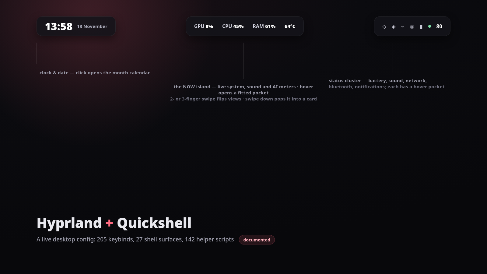

# hyprland

My own Hyprland configuration — versioned, editable, and **live**.

| | |
|---|---|
| Distro | CachyOS (Arch-based) |
| Compositor | Hyprland 0.56.x — Lua config era (`hyprland.lua`, not `hyprland.conf`) |
| Desktop shell | Quickshell (`qs -c ii`), illogical-impulse style |
| Base | [end-4/dots-hyprland](https://github.com/end-4/dots-hyprland) |
| Licence | GPL-3.0 (derived from end-4/dots-hyprland) |
| Repo location | `~/hyprland` |
| GitHub | [MatrixZockt/matrix-dotfiles](https://github.com/MatrixZockt/matrix-dotfiles) |
| Live config | `~/.config/hypr` → symlink to `~/hyprland/.config/hypr` |

`~/.config/hypr` **is** this repo. Edit a file here, run `make reload`, and the running
desktop picks it up. Git is your undo button — any change can be reverted.



## What this is

A whole desktop, not a colour scheme. A Hyprland session, a Quickshell shell and the
scripts and units that keep the two alive through suspend, GPU switching, a wedged
session or a dead shell — all versioned here while staying live: `~/.config/hypr` is
a symlink into this repo, so an edit is one reload away and git is the undo button.

**Highlights**

- A bar with islands and panels, a notification centre, a lock screen and a login
  theme that share one palette.
- Clipboard history with picture previews: a copied screenshot appears in the
  top-right card with a download button, freezes while you hover it, and saves to
  `~/Pictures/Screenshots` on click.
- A file manager, a wallpaper selector, an app launcher, a keybind cheat sheet and
  screen snips, all in the shell rather than in a dozen separate apps.
- Power handling that follows the machine: profiles, GPU switching, sleep/resume
  hooks, a lid guard, a CPU watchdog and a shell watchdog.
- Every surface documented in [docs/FEATURES.md](docs/FEATURES.md) with the file
  that implements it.

## Quick start

```bash
git clone https://github.com/MatrixZockt/matrix-dotfiles ~/hyprland
cd ~/hyprland
./install.sh     # link this repo into ~/.config and install the small helpers
make reload      # restart Hyprland with it
```

Built for Hyprland 0.56+ with the Lua config and the illogical-impulse package set;
`./install.sh --dry-run` prints what it would do before it does it.

**Not in this repo, on purpose:** wallpapers and other third-party art, anything
specific to one machine's hardware, and every secret, hostname or personal path.
The wallpaper selector therefore opens empty and offers an **Add wallpaper** button
that applies a picture you choose and keeps it in your own collection.

## Documentation

| Document | What it covers |
|---|---|
| **[docs/FEATURES.md](docs/FEATURES.md)** | Every feature the desktop offers — each shell surface, the compositor layers, hardware and power handling, session integration and tooling, with the file that implements it |
| [docs/KEYBINDS.md](docs/KEYBINDS.md) | All 205 binds, generated from the running session |
| [docs/music-and-background-apps.md](docs/music-and-background-apps.md) | Music playback and how background apps are handled |

More figures: [how the config loads](docs/images/config-layers.png) ·
[the feature surfaces](docs/images/feature-surfaces.png)

---

## Layout

```
~/hyprland/
├── .config/
│   └── hypr/                  ← this is ~/.config/hypr (symlinked)
│       ├── hyprland.lua       entry point: loads base, then custom
│       ├── hyprland/          base config (upstream illogical-impulse)
│       │   ├── general.lua    look & feel, input, animations
│       │   ├── keybinds.lua   all keybinds
│       │   ├── execs.lua      what starts at login
│       │   ├── rules.lua      window rules
│       │   ├── env.lua        environment variables
│       │   ├── colors.lua     generated colors (shell-synced)
│       │   ├── services/      service helpers
│       │   └── scripts/       helper scripts
│       ├── custom/            ★ YOUR CHANGES GO HERE
│       │   ├── keybinds.lua   extra/overriding keybinds
│       │   ├── general.lua    overriding settings
│       │   ├── variables.lua  overriding apps (terminal, browser, ...)
│       │   ├── execs.lua      extra autostart
│       │   └── rules.lua      extra window rules
│       ├── hyprlock.conf, hypridle.conf, hyprlock/   lock & idle
├── docs/KEYBINDS.md           generated keybind cheat sheet
├── scripts/                   repo tooling (not part of the config)
├── extras/                    copied into ~ by install.sh (entries, icons, bin/)
│   ├── applications/          .desktop files (freebuff, appimage-run handler)
│   ├── bin/                   the ~/.local/bin helpers the config calls:
│   │                          appimage-run, the power
│   │                          stack (power-autoswitch, power-failsafe,
│   │                          ppd-nvidia-boost), the GPU launch helpers,
│   │                          the local llama server, session-env/session-doctor
│   ├── etc/polkit-1/          rules for passwordless mount/lid changes
│   ├── sbin/                  ii-recover (session recovery helper)
│   ├── share/polkit-1/        polkit actions for the helpers above
│   ├── systemd/user/          the user units that back all of the above
│   └── icons/                 hicolor icons for the entries above
├── install.sh                 link this repo into ~/.config on a new machine
├── Makefile                   make reload / check / keybinds / save / push
└── LICENSE
```

## How the config loads

`hyprland.lua` requires the base files first and the `custom/` files after:

```lua
require("hyprland.lib")            -- helpers
require("hyprland.services")
require("hyprland.env")            -- env vars
require("hyprland.execs")          -- autostart
require("hyprland.general")        -- general settings
require("hyprland.rules")          -- window rules
require("hyprland.colors")
require("hyprland.keybinds")

if is_file_exists(HOME .. "/.config/hypr/custom/general.lua") then
    require("custom.general")      -- ← your overrides applied last
end
```

So the base is the canvas, and `custom/` is where your own preferences live. Keeping
personal changes in `custom/` means upstream updates to the base layer stay mergeable.

## The edit loop

```bash
# 1. change something
$EDITOR ~/.config/hypr/custom/keybinds.lua

# 2. apply it to the running session
make reload          # reload + report config errors (non-zero exit = real error)

# 3. save it forever
make save m="add my own terminal keybind"
make push            # send to GitHub
```

Handy extras:

```bash
make help            # list all commands
make check           # show errors from the last load
make keybinds        # refresh docs/KEYBINDS.md from what's actually bound
make status          # what's uncommitted right now
```

`make reload` printing `✔ reloaded — no config errors` means the config is healthy.
Anything else is a genuine error and must be fixed before it can bite you at login.

## Keybinds

Full table: **[docs/KEYBINDS.md](docs/KEYBINDS.md)** — generated from the running
session, so it always reflects reality. Regenerate with `make keybinds`.

The essentials:

### Windows

| Keys | Action |
|---|---|
| `SUPER` + `LMB` drag | move a window |
| **drag a window EDGE** | **resize it — no modifier needed** |
| `SUPER` + `RMB` drag | resize a window |
| `SUPER` + `Escape` *(or* `SUPER` + *scroll-down)* | **window controls menu** — close / minimize / maximize / fullscreen / float / pin / center, acting on the window you are looking at |
| `SUPER` + `Q` | close the window outright |
| `SUPER` + `D` | **show desktop** — hides every window; press again and each one goes back to the workspace it came from |
| `SUPER` + `ALT` + `D` | maximize / restore |
| `SUPER` + `F` | fullscreen |
| `ALT` + `Tab` | window switcher — if the focused window is fullscreen it opens the overview of **this workspace's** windows; otherwise it makes the window fullscreen first |
| `SUPER` + `ALT` + `H` | minimize (hide the window) |
| `SUPER` + `SHIFT` + `H` | show minimized windows |
| `SUPER` + `ALT` + arrows | resize with the keyboard (hold to repeat) |
| `SUPER` + `SHIFT` + `R` | **visual resize frame** — an accent-colored frame with drag handles appears around the focused window (works over fullscreen, tiles and floats alike); drag any edge/corner to resize live, center handle moves floating windows, arrow keys nudge the size (`Shift` = bigger steps), `Esc`/`Enter` or a click on another window or 15s idle release it. Also in every dock icon's right-click menu as "Resize…". Implementation: the shell's `VisualSizer` overlay (`services/VisualSizer.qml` + `modules/ii/visualSizer/VisualSizerWindow.qml`), armed via `qs -c ii ipc call sizer armFocused` |
| `SUPER` + arrows | focus a window |
| `SHIFT` + `SUPER` + arrows | move a window |
| `SUPER` + `ALT` + `Space` | float / tile toggle |
| `SUPER` + `P` | pin on all workspaces |
| `SHIFT` + `SUPER` + `ALT` + `Q` | force-kill a frozen window |
| `SUPER` + `1..0` | switch workspace |
| `ALT` + `SUPER` + `1..0` | send window to a workspace |

### Everything else

| Keys | Action |
|---|---|
| `SUPER` (tap) | search / launcher — the **command menu**, see below |
| `SUPER` + `Return` | terminal |
| `SUPER` + `Tab` | overview (the same panel `ALT` + `Tab` uses) |
| `SUPER` + `/` | keybind cheat sheet |
| `SUPER` + `S` | **screen snip** — drag a region to screenshot and annotate it |
| `CTRL` + `SUPER` + `S` | scratchpad show/hide (this is what `SUPER` + `S` used to do) |
| `SUPER` + `ALT` + `S` | send the focused window to the scratchpad |
| `SUPER` + `L` | lock screen |
| `SUPER` + `V` | clipboard history |
| `CTRL` + `SHIFT` + `Escape` | **task manager** — btop: process list plus live CPU / RAM / network / disk graphs |
| `SUPER` + `E` | file manager |
| `Print` / `CTRL` + `Print` | screenshot |
| `CTRL` + `SUPER` + `T` | change wallpaper |
| `CTRL` + `ALT` + `Delete` | session menu (log out, reboot, ...) |

### The command menu

The command menu is the shell's search panel: **tap `SUPER`**. It is both an app
launcher and a run-anything box — the first character picks the mode:

| Prefix | Mode |
|---|---|
| *(none)* | apps |
| `/` | **actions** — toggle dark mode, take a screenshot, lock, log out, ... |
| `$` | run a shell command |
| `=` | calculator |
| `;` | clipboard history |
| `:` | emoji |
| `?` | web search |

`SUPER` + `/` opens the cheat sheet instead: every keybind in the running
session, including the ones documented nowhere else.

Edge-resize with no modifier comes from `general:resize_on_border`, enabled in the
base config. The controls menu, show-desktop, minimize/restore and keyboard-resize
binds are added in `custom/keybinds.lua`.

**Why there is no plain-left-button drag:** it was tried and removed. A pixel
threshold cannot distinguish a title-bar grab from a drag *inside* an app, so
selecting text or dragging a slider moved the whole window instead — which
scattered every window on the desktop. Moving windows is therefore `SUPER` + left
drag, which is unambiguous. See the comment at the top of `custom/keybinds.lua`.

**Why the window buttons are a menu, not title-bar buttons:** Hyprland never
draws window decorations — no title bar, no close/minimize/maximize buttons. That
is a design decision of the compositor, not a config gap. Real buttons need a
compositor plugin (`hyprbars`, built with `hyprpm`), which was not installed;
the `SUPER` + `Escape` menu gives the same actions from inside any application.

## Local changes vs. upstream

This config deviates from stock end-4 in a few deliberate ways:

1. **Keyboard layout is `de`**, not the stock `us` — overridden in
   `custom/general.lua` (the base file says `us`; custom wins).
2. **Mouse drag/resize binds use `{ drag = true }`**, not `{ mouse = true }` — in
   `hyprland/keybinds.lua`. `mouse = true` is *silently ignored* by Lua binds in
   Hyprland 0.56.x ([upstream issue #15700](https://github.com/hyprwm/Hyprland/issues/15700)),
   which is why window dragging didn't work out of the box.
3. **Display scale is 1.25** (`custom/general.lua`) because this panel is ~198 DPI
   and the stock scale of 1 drew everything far too small. Hyprland resolves 1.25
   to the nearest scale that keeps the logical resolution integral, which on this
   panel is **1.175** → a 1920x1280 desktop. `hyprctl monitors` shows the real
   value, and it is what the shell lays out against.
4. **`SUPER` + `S` is the screen snip** and the scratchpad moved to
   `CTRL` + `SUPER` + `S` (`custom/keybinds.lua`).
5. **`SUPER` + `D` is show-desktop** and maximize moved to `SUPER` + `ALT` + `D`.
   Show-desktop remembers each window's workspace in
   `~/.cache/hypr-show-desktop.tsv`, so the second press restores positions
   instead of dumping everything onto one workspace.
6. **Window controls menu** (`custom/scripts/window-controls.sh`) on
   `SUPER` + `Escape` / `SUPER` + scroll-down, drawing its menu with fuzzel.

Each is marked with a comment in the file. If you later merge an upstream update,
check these spots first.

## Desktop shell changes (`~/.config/quickshell/ii`)

The bar, clock and dock are Quickshell QML, not Hyprland config, so they are also
versioned here. Changes made to the stock shell:

- **Clock**: moved to the left of the bar, time set much larger than the rest of
  the bar, date (`dd MMMM`, e.g. "12 September") smaller and to its right.
- **Bar title widget removed**, along with the top-left icon button and the
  on-screen-keyboard button.
- **Calendar**: the right sidebar's Calendar tab was removed; the month calendar
  now opens in the popup from the clock/date in the bar.
- **Dark/light and snip buttons enlarged** (`CircleUtilButton` gained a
  `buttonSize`, so a button can be made easier to hit without changing its icon).
- **Bottom dock**: floating, with a gap above the screen edge, hidden until the
  pointer reaches the bottom (then it lingers ~2.5s), real app icons, and the pin
  and overview buttons removed.
- **App icons**: apps whose icon cannot be resolved no longer fall back to the
  literal `image-missing` placeholder (which drew a broken glyph); Freebuff gets a
  real desktop entry and logo from `extras/applications/`.
- **Middle island (NOW bar)**: hovering no longer extends it into a detail
  pocket — the island reacts only when it is genuinely open. The three-finger
  swipe down still pops it out into the floating card, and while the card is
  open the island itself grows slightly and takes the accent border, so the
  card reads as that island enlarged (the old pale glow slab behind the card
  is gone). A pocket left open from another path is disarmed when the card
  opens, so the two can never overlap (`NowBar.qml`, `BarContent.qml`,
  `NowBarPanel.qml`).
- **Hover pocket (the drop-down box)**: the box now FITS whatever it shows —
  content is measured instead of sitting in a fixed-size slab, with one even
  frame of clearance on every side, and the width quantizes UP in 8px steps
  so nothing is clipped at the wall. The now-bar pocket's performance view
  gained real content: the four full-size gauge tiles (label, value, caption,
  sparkline) plus a "busiest right now" line — the same data the island
  shows, spelled out.
- **Performance view no longer flickers on refresh**: the gauge tiles in the
  island, the popped-out card and the pocket are built ONCE from a static
  identity list, and the live numbers re-bind through helper functions per
  sample. Previously the values lived in the Repeater's model, so every 1 Hz
  sample rebuilt all four tiles from scratch — the lag/glitch when the view
  refreshed itself (`NowBar.qml`, `NowBarPanel.qml`, `BarContent.qml`).
- **Three-finger swipes move windows through the tiling field (rewritten
  2026-09-27)**: `custom/scripts/field-move.py` no longer models an idealized
  dwindle grid (it mixed physical monitor pixels with logical window coords
  on the 1.6x display and then fired a tree swap that often had no legal
  target — the "swipe and nothing happens" bug). The new semantics, all
  verified live on real layouts:
  * **left / right** — the focused window RELOCATES to that side via the
    compositor's `move{window, direction}`: it joins the column there and
    the opposite side expands to fill the space. A top browser swiped
    right lands right and the left half expands; every reflow is the
    compositor's own.
  * **up / down** — if a window sits directly above/below in the column,
    the two swap positions. If the window instead SPANS this column and
    sticks out past it (the full-width browser over a half-width terminal
    shape), the spanner snaps SIDEWAYS away from the focused window —
    right if we are on the left half, left if on the right — which makes
    the focused window grow to its full column height. "The browser above
    snaps to the right to make space."
  * **when a swipe truly cannot apply** (one window on the desktop,
    floating window, fully extended into empty space) the window WIGGLES —
    two quick grow/shrink bumps of its own edge (~0.4s) via
    `resize{window}`, which works on tiled windows without touching the
    tree. The old "Fields: no field that way" notification is retired.
  * Verified live: relocate+expand on the top-spanner layout, spanner
    snap-aside (focused window grew 791x438 → 791x927), and the wiggle
    sampled mid-flight (438 → 460 → 416 → 438). Keyboard twins:
    CTRL+SUPER+arrows.
- **The "+" desktop slot is a line, not a dot (2026-09-27, second pass)**:
  the trailing add-desktop slot in the ball-and-line widget no longer morphs
  into the accent ball when it is the active desktop — it is a LINE like
  every other desktop, always. Inactive: a short faint line in the same
  `colOnLayer1Inactive` tone as the "+" glyph it carries. Active: the line
  ILLUMINATES — it grows to a longer accent-colored dash (wider than the
  glyph, so the line is what reads) and the "+" symbol itself recolors to
  the accent; no dot background behind the symbol anywhere. Hover keeps its
  brighten-pop. Implementation: `Workspaces.qml` `plusSlot`/`morphsToBall`
  split plus `plusActiveDash` (18 compact / 26 bar). Verified by pixel
  probe: the active slot renders a solid 41px accent line (rows 50–53 at
  1.6x) with the glyph in the same accent; inactive slots are 5px-thick
  faint lines.
- **Sidebars close instantly on cursor-leave (2026-09-27)**: both sidebars
  now auto-close ~200ms after the pointer leaves them — the small buffer
  only absorbs crossing to a nested control, never reads as lag. The LEFT
  sidebar already had the mechanism (passive `HoverHandler` + short-grace
  `mouseOutTimer`, armed only after the pointer was actually inside so a
  keyboard/IPC open never self-closes); the RIGHT sidebar had none (Esc,
  click-away or the shortcut were the only exits) and now runs the same
  contract at a shared 200ms grace (left was 220ms). Implementation:
  `SidebarRight.qml` gains `pointerWasInside` + `windowHover` +
  `mouseOutTimer`; `SidebarLeft.qml` timer interval unified.
- **Right-island edit mode covers every icon (2026-09-27)**: the sidebar's
  "Edit quick toggles" picker (shared with Settings › Bar, one list in
  `TopBarIconPicker.qml`) now also switches the pill's live chips:
  "Muted mic chip" (`bar.indicators.mic`) and "Notification bell chip"
  (`bar.indicators.notifications.show`). Previously the mic-off and bell
  chips appeared whenever the state applied, with no way to remove them
  from the bar — now every icon the right island can show is removable
  from edit mode. The unread ping inside the bell follows the bell
  switch; the muted-SOUND chip deliberately follows the existing
  "Sound" switch (one mute icon per device state, not two switches for
  one thing).
- **View swiping with 2 OR 3 fingers**: horizontal swipes with either finger
  count flip the middle island's views — with the card open, the same swipes
  flip the card. Two-finger swipes arrive as wheel events (both surfaces now
  route them through one shared pixel-path classifier in `NowBar`); three-
  finger swipes never reach layer surfaces, so `custom/general.lua` registers
  them as gestures firing the shell's `nowbarModeNext` / `nowbarModePrev`
  shortcuts. The panel's swipe handler also had a real bug (`root.swipeReset`
  is an id, not a property — it threw before the mode step, so horizontal
  swipes over the card did nothing at all); fixed.
- **Four-finger tap opens the desktops overview**: resting four fingers on
  the pad briefly opens the REAL zoomed-out grid (the same `OverviewWidget`
  SUPER+Tab peeks): every desktop drawn to scale on its own wallpaper, the
  windows rendered live by screencopy at their true positions inside their
  tile — no numbers, no labels; the wallpaper and the windows ARE the
  label. The desktop you are on wears the accent ring. Click a tile to
  jump, tap again to dismiss, click anywhere off the grid to close. It is
  the tap-mode variant on purpose: the key-held peek's compositor focus
  grab self-clears without a held key and would close the grid ~2.5s in,
  so tap mode runs grab-less and modal-less (the tap-away catcher does the
  dismissing). It used to mirror SUPER+D's show-desktop; that action keeps
  its key only. The tap obeys the popup guard — with a popup card open,
  the gesture belongs to the card, never to navigation. Wiring: the
  tracker's `tap` phase (now tagged with the finger count at gesture
  start) → `TouchpadSwipe.tapTriggered(count)` → `shell.qml` →
  `custom/popup.lua: desktopsOverview()` → the shell's `search
  tapWorkspaces` IPC.
- **Three-finger tap opens the wallpaper carousel — only where nothing is
  open**: on an empty desktop the same tap enters the desktop edit canvas
  with the carousel pill (identical to the show-desktop jump's landing);
  on a desktop with windows it is a deliberate no-op so the gesture never
  interrupts real work. Same routing as the 4-finger tap, ending in
  `custom/popup.lua: wallpaperCarousel()`, which shares one
  `is_workspace_empty()` definition with showDesktop. (Both taps ride the
  evdev tracker; device access comes from a udev `uaccess` rule for
  touchpads, `/etc/udev/rules.d/70-touchpad-uaccess.rules` — no group
  membership or re-login needed.)
- **Brightness keys on a laptop that exposes two backlights**: such a machine
  reports two backlight devices, and plain `brightnessctl` picks the discrete
  GPU's, which drives nothing visible — the panel is the integrated GPU's. The
  shell's brightness service (read AND write) and the keybind fallbacks all
  go through `~/.config/quickshell/ii/scripts/system/brightness-device.sh`,
  which resolves the real panel backlight from the DRM state (connected
  eDP connector) instead of enumeration order. The service also re-reads the
  device before every keyboard step, because external writers (the idle
  screensaver's dim/restore) can change the backlight behind its back — a
  step from a stale value read as "the keys do nothing".
  (`services/Brightness.qml`, `keybinds.lua`.)
- **Volume keys**: registered and working (`wpctl` on the PipeWire sink, with
  a 150% limit); mute and mic-mute too. If a media/brightness key still does
  nothing after this, the likely culprit is the key never reaching the
  kernel (keyboard firmware) — check with `evtest` on the keyboard nodes
  under `/dev/input`.
- **Now-bar tab order and tick reveal**: the popped-out card's tab chips lead
  with **System** (visual order only — swiping still cycles the ring in the
  original order), and the island's resting view is System too: the auto
  chain is now timer → sound → System, with AI usage swipe/card-only (an
  active meter used to hold the resting view indefinitely). The tick rows on
  the island and in the card are hidden at rest and appear only when the
  view changes, answering "where did it land?", then fade away (shared
  `GlobalStates.nowBarTickHint` flag, ~1.6 s); while hidden they reserve no
  space — the island's content sits dead centre and the card's header row
  collapses to zero height until the ticks show.
- **GPU naming**: `HardwareStats.rankGpus` cleans `lspci`'s raw lines (the
  human model name is the LAST bracket group — `[Vendor Device]` → the model,
  never the vendor alias) and sorts any discrete GPU (NVIDIA/GeForce, Radeon
  RX, Arc) ahead of the iGPU, since every consumer reads `[0]` as "the
  graphics card". On an Optimus laptop the iGPU used to be shown for the whole
  machine. Not hardcoded — whatever dGPU the machine carries wins.
- **Scrolling parity with Brave**: touchpad scrolling in the shell's own apps
  is now 1:1 pixel tracking — `StyledFlickable`/`StyledListView` apply the
  pixel deltas directly and suspend the eased Behavior while a touchpad
  stream runs (libinput momentum already inside it, exactly as Chromium
  consumes it); mouse-wheel notches keep the eased animated step
  (`mouseScrollFactor` 120 ≈ Brave's per-notch distance). Kitty matches the
  distance side (`wheel_scroll_multiplier 5.0` ≈ 115px/notch) and gets a
  workable touchpad factor (`touch_scroll_multiplier 4.0`); kitty has no
  scroll-animation option, and it reads config at launch only.
- **Loading line → status channel**: the fine full-bar line is now the
  desktop's general indication channel (`services/StatusSignal.qml`), not
  just the app-launch wait. Three faces: the charge (app opening, owned by
  `GlobalStates`), the red failure flash, and one-shot full-width **blinks**
  in a caller-supplied colour — charger plugged in blinks battery-green,
  unplugged blinks neutral. Scripts and keys can fire one via
  `qs -c ii ipc call status blink "#RRGGBB" "text"`. Over a fullscreen app
  (where the bar is hidden) the same pulse renders as a tiny tell in the
  top-right corner (`modules/ii/bar/StatusTell.qml`, Overlay layer,
  input-transparent, only while a fullscreen window is up).
- **App launches: dead desktop entries never surface, re-clicks never
  double-spawn.** Two things made opening apps flaky (Freebuff worst). A
  stale entry (`~/.local/share/applications/freebuff.desktop`, execing a
  0.0.109 AppImage that had been cleaned out of `~/Downloads`) kept matching
  searches — clicks on it died with exit 127, reported as "Couldn't open"
  seconds later. Freebuff's own session RE-CREATES that file when deleted
  (observed: back within minutes — its own session DB in
  `~/.config/freebuff-desktop/` remembers the file), so `AppSearch` now
  dead-lists entries whose exec target is gone (`execString` first word vs
  `-x`/PATH) and filters them out — an unresolvable exec line keeps an entry
  (unknown ≠ dead). The probe runs at boot (on the entries actually arriving
  — the change signal alone raced the load), on every catalogue change, and
  on a 45 s sweep, so a re-created dead file resurfaces in the launcher for
  at most ~45 s, never for ever. Second: a slow AppImage left a
  multi-second window where the window list still showed nothing, so
  impatient re-clicks spawned competing copies; `GlobalStates.openApp` now
  folds a same-command re-click into the launch already in flight (cleared
  when any window appears, on failure, or after 12 s). `open.sh` names the
  missing target for exit 126/127 and stamps shell-launched trees with
  `II_OPENED_BY_II` so app re-execs (updaters) can't misreport a long-running
  app's death as a failed launch. Diagnosis hook:
  `qs -c ii ipc call search debugApps "name"` now prints each match's exec
  line.
- **Four-finger swipe UP on an empty desktop opens the carousel with the
  swipe** (`WallpaperSwipe.qml`, `WallpaperModal.qml`, `general.lua`): the
  compositor's 4f-up gesture is split by desktop state — empty: the Lua
  `start` callback fires `quickshell:wallpaperSwipeOpen` at the swipe's
  START, the shell's stage maps on the first travel frame and follows the
  fingers 1:1 (tracker `total`, up = negative), and the `finish` trigger
  commits (stage settles) or aborts a too-tiny drag (slides away); busy:
  exactly what it was, the fullscreen toggle. A 4-finger TAP still falls
  through to the desktops overview (the stage only opens past 4% travel),
  popup apps keep the gesture entirely (`PopupApps.anyPresent`), and four
  fingers DOWN over an open carousel close it. Scope trap recorded in place:
  `desktopIsEmpty` is declared BELOW the gesture in general.lua, so the
  closures use `popup.is_workspace_empty` instead. Scripted test of the whole
  state machine: `hyprctl eval 'hl.dispatch(hl.dsp.global(
  "quickshell:wallpaperSwipeOpen"))'` → `qs -c ii ipc call wallpaperStage
  swipeFrame 0.35` → `...Finish"))'` → `qs -c ii ipc call wallpaperStage
  swipe` for state.
- **The desktop pill stays on an empty desktop, and winks goodbye when the
  desktop is reclaimed** (`DesktopIndicator.qml`, `Workspaces.qml`): the
  bottom desktops capsule was a pure glance — 1.4 s after a switch it was
  gone, which emptied the one screen where the dots matter most. Now: while
  the ACTIVE desktop has no windows (per-monitor, same predicate
  GlobalStates uses), the pill stays — two seconds minimum, for as long as
  the emptiness lasts (fullscreen still suppresses it: a stay is persistent
  chrome, a flash is not). The moment an app opens on THAT desktop (same
  workspace id — switching to a busy desktop is the ordinary flash, not a
  reclaim), the active ball plays one squash-and-stretch wink
  (`farewellPulse` → scale 1→1.45→0.8→1, ~0.7 s) and the pill dissolves; a
  reclaim inside the stay's first two seconds keeps the pill up to the full
  mark. State via `qs -c ii ipc call desktopPill state`.
- **Right-island hover boxes and notification previews** (`BarContent.qml`,
  `NotificationPopup.qml`): every right-island liquid pocket (battery, sound,
  network, bluetooth, and the new notifications preview) now clamps against
  the right island's left edge, so a wide drop slides LEFT inside the island
  instead of crossing onto the middle one ("positions show off from the
  bar's length"). Hovering the unread-notifications chip opens a
  `notifications` pocket showing the LAST notification as it arrived (app ·
  time, summary, up to three body lines) — the click still opens the
  sidebar's list. Notification popups no longer detach in the screen's
  top-right corner: they hang directly below the bar, aligned with the
  battery/status cluster (top margin = bar height + gap). Verified via the
  `bar pocketAt` test hook and screenshots; note `notify-send` is broken on
  this install (libnotify symbol error) — test notifications go through raw
  `dbus-send ... org.freedesktop.Notifications.Notify`.
- **Board task batch (2026-09-27)**: settings and task-manager windows inset
  26px per side (`settings.qml anchorMargin`, `taskmanager.qml` card) —
  slightly smaller, less dead air; sidebar edge-hover intent delay extended
  300→450ms (`EdgeReveal.qml`); now-bar ring reordered so **System is tab 0**
  (its tick is the leftmost dot under the island and the default view —
  `NowBar.qml`, `GlobalStates.nowBarMode` default 0); the desktop pill's
  "+" glyph re-centred via `anchors.fill` and recoloured into the empty-dash
  family (`Workspaces.qml`); GPU rows stop attributing the iGPU's clock to
  the idle dGPU — only the card owning `gt_cur_freq_mhz` (the Intel) shows a
  live clock, the NVIDIA row honestly says "idle · no processes"
  (`PerformanceView.qml`, `HardwareView.qml`); right-click on a task-manager
  row now opens a properties menu (End task / Force kill / Copy name) instead
  of instantly force-killing (`ProcessesView.qml`, needs `Quickshell` import
  for PopupWindow); dock icons get a right-click properties menu (Pin /
  New window / Close all windows — closes via Hyprland dispatch by
  `HyprlandToplevel.address`, since QML Toplevel has no close() in this
  build) (`DockAppButton.qml`); the 4-finger-swipe-down close now verifies
  450ms after the close dispatch and, if the app survived (a save
  confirmation answered No), springs it back to its slot and re-anchors it
  fullscreen/tiled as it was (`general.lua` commit path) — verified by code
  path only, needs a real gesture to feel.

`Config.options` for these live in `~/.config/illogical-impulse/config.json`
(also tracked here): bar position/clock verbosity, dock enablement, overview grid
size (set to 1x1 so `ALT` + `Tab` shows this workspace's windows rather than a grid
of all workspaces) and the search prefixes.

## Applications

- **Task manager**: `CTRL` + `SHIFT` + `Escape` → `btop` (pinned in
  `custom/variables.lua`). No GUI task manager is installed on this machine; btop
  gives a grouped process list plus CPU / memory / network / disk graphs and is
themed to match (`color_theme = "noctalia"`).
- **File manager**: `SUPER` + `E` → the **Explorer** app
  (`~/.local/bin/hypr-explorer` → `~/.local/lib/hypr-explorer/explorer.py`, a
  custom GTK4 file manager; Dolphin is retired from the bind). Multi-instance
  by design (like the terminal): every launch is its own window. Its picker
  mode also serves as the shell's FileChooser portal (`custom/ii-portal.py`).
  Each new window floats and anchors itself to the right edge of the focused
  monitor, over fullscreen windows. **Scale gotcha (fixed 2026-09-27)**:
  `hyprctl monitors` reports PHYSICAL pixels while window move/resize
  dispatches are LOGICAL; the anchor math once mixed them, landing new
  windows past the right edge of this 1.6x-scaled display (the "opens for
  1ms then vanishes" bug). The anchor now converts by the monitor's scale
  and clamps on-screen; windows are pinned to Wayland class
  `org.hypr.Explorer`, which every compositor rule matches.
  (Historical Dolphin theming notes: `widgetStyle` is `Breeze` in
  `~/.config/kdeglobals`; default view Details.)
- **AppImages and loose executables**: double-clicking an `.AppImage` in the file
  manager runs it, Windows-`.exe`-style. `install.sh` registers
  `extras/applications/appimage-run.desktop` as the default handler for
  `application/vnd.appimage` and the loose-executable mime types, so `gio open` —
  the command the shell's own QML file manager runs on a double-click — executes
  the file through `extras/bin/appimage-run`. The handler sets the exec bit on
  the fly (browsers strip it on download) and `exec`s the file. The registration
  lives in `~/.config/mimeapps.list`, so it is permanent across reboots; a
  default set later by the user or another tool always wins. Shell scripts are
  deliberately NOT covered — double-clicking a `.sh` never auto-runs it.

## Updating the base from upstream end-4

The base layer under `hyprland/` came from
[end-4/dots-hyprland](https://github.com/end-4/dots-hyprland). That clone still exists at
`~/dots-hyprland`, but it is only the **installer** now — your live config is this repo.

Before any upstream update, always snapshot first:

```bash
make save m="snapshot before upstream update"
```

Their installer copies files straight into `~/.config/hypr`, which — because of the
symlink — writes **into this repo**. That is recoverable (git will show you exactly what
it changed, and `git checkout -- .` undoes it), but committing first is what makes it
recoverable. After an update, re-check the two local patches above, then `make reload`.

## Restoring this setup on a fresh machine

```bash
git clone https://github.com/MatrixZockt/matrix-dotfiles.git ~/hyprland
~/hyprland/install.sh        # links ~/.config/*
make reload
```

On a brand-new system you also need the desktop stack itself (Hyprland 0.56+,
Quickshell, the illogical-impulse packages). The pragmatic order is: install
[end-4/dots-hyprland](https://github.com/end-4/dots-hyprland) first (`./setup install`),
then run `~/hyprland/install.sh` so your config wins.

## Licence

**GPL-3.0.** This configuration is a derivative of
[end-4/dots-hyprland](https://github.com/end-4/dots-hyprland), which is licensed
GPL-3.0, so the whole repository — base layer, shell and the local additions in
`custom/` and `extras/` — is distributed under the same terms. The full text is in
[LICENSE](LICENSE).

If you redistribute it or a modified version, keep the licence, keep the attribution to
end-4 for the base, and state what you changed.

## Gotchas

- **Never run an installer that writes to `~/.config/hypr` while this repo is linked** —
  it will write *through* the symlink and modify your repo. Commit first; git will then
  show you exactly what it changed and let you revert it.
- The base layer under `hyprland/` is upstream code. Personal edits belong in `custom/`.
- `colors.lua` and `hyprlock/colors.conf` are regenerated by the shell's theme system.
- Don't commit secrets. `.gitignore` covers `.env`-style files — keep it that way.
