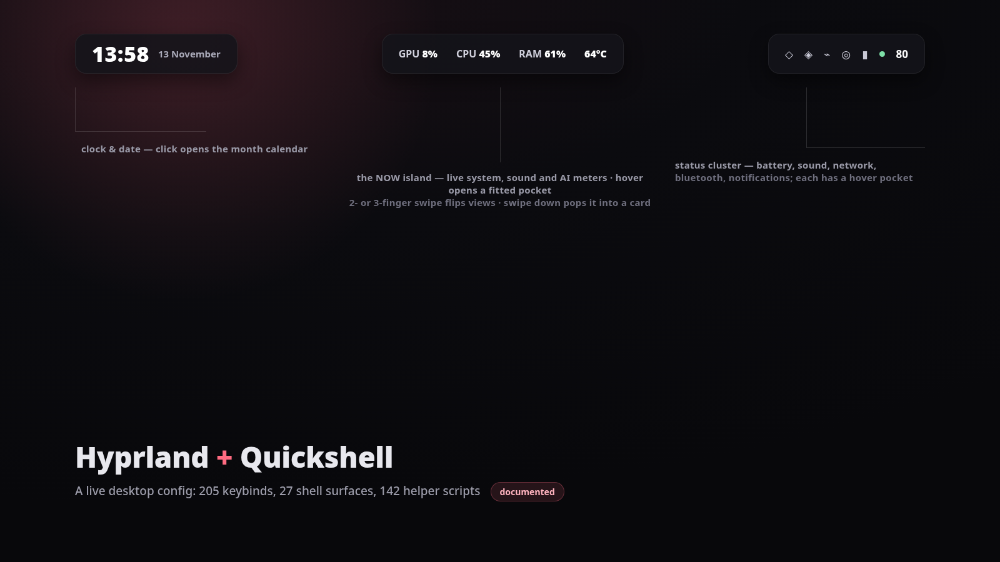
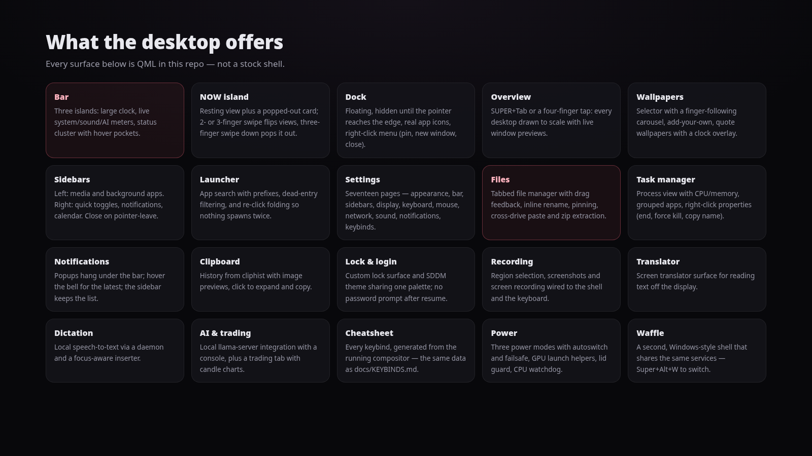
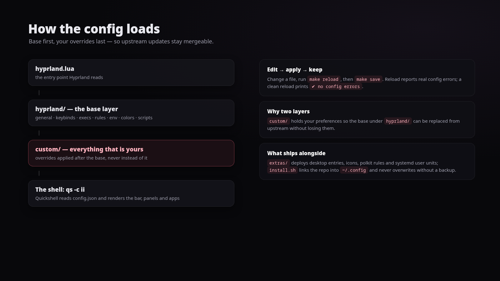

# Features

Everything this configuration does, surface by surface, with the file that
implements it. The README explains the layout and the edit loop; this page is the
reference for *what exists*.



**At a glance**

| | |
|---|---|
| Compositor | Hyprland 0.56.x, configured in **Lua** (`hyprland.lua`, not `hyprland.conf`) |
| Shell | Quickshell, run as `qs -c ii` (illogical-impulse style) |
| Keybinds | 328, all listed in [KEYBINDS.md](KEYBINDS.md) |
| Shell surfaces | 27 modules under `.config/quickshell/ii/modules/ii/` |
| Helper scripts | 142 shell/Python scripts under `.config/` |
| Base | [end-4/dots-hyprland](https://github.com/end-4/dots-hyprland), GPL-3.0 — see [Licensing](#licensing-and-credits) |

---

## The shell

The bar, panels and built-in apps are QML — they are part of this repository, not a
stock shell. Every surface lives under `.config/quickshell/ii/modules/ii/`.



### Bar

Three independent islands on a transparent strip.

- **Left — clock.** Time set much larger than the rest of the bar, date (`dd MMMM`)
  smaller to its right. Clicking it opens the month calendar in a popup; the
  sidebar's own Calendar tab is gone. (`bar/ClockWidget.qml`, `bar/BarContent.qml`)
- **Middle — the NOW island.** The resting view cycles system → sound → System, with
  a live gauge for each; the AI-usage meter is reachable by swipe or card only, so it
  never pins the resting view. Hovering opens a **pocket** that measures its content
  instead of using a fixed slab, with the width quantised up in 8 px steps so nothing
  clips. The performance pocket carries the same four gauge tiles as the island plus
  a "busiest right now" line. Tiles are built once and re-bound per sample, so the 1 Hz
  refresh no longer flickers or rebuilds the view. (`bar/NowBar.qml`,
  `bar/NowBarPanel.qml`)
- **Right — status cluster.** Battery, sound, network, bluetooth, microphone, the
  notification bell and the tray. Every pocket clamps against the island's left edge
  so a wide drop slides left instead of crossing into the middle island. Editor mode
  can remove any chip, including the mute-mic and bell chips. (`bar/BarContent.qml`)

**Status channel.** The thin full-bar line is a general indication channel, not just
an app-launch wait: the launch charge, a red failure flash, and one-shot full-width
blinks in a caller-supplied colour (charger plugged in blinks green, unplugged
neutral). Over a fullscreen app, where the bar is hidden, the same pulse renders as a
small tell in the top-right corner. Scriptable:
`qs -c ii ipc call status blink "#RRGGBB" "text"`. (`services/StatusSignal.qml`,
`bar/StatusTell.qml`)

### NOW island card and gestures

- **Three-finger swipe down** pops the island out into a floating card; the island
  itself grows slightly and takes the accent border so the card reads as that island
  enlarged.
- **Two- or three-finger horizontal swipes** flip the island's views, and flip the
  card's tabs while it is open. Two-finger swipes arrive as wheel events and are
  routed through one shared pixel-path classifier; three-finger swipes never reach
  layer surfaces, so they are registered as compositor gestures instead.
- **Tab order** on the card leads with System; the tick rows appear only when the view
  changes, then fade, and reserve no space while hidden.

### Dock

Floating, with a gap above the screen edge, hidden until the pointer reaches the
bottom and lingering ~2.5 s afterwards. Real app icons, no pin or overview buttons.
Right-clicking an icon opens a properties menu (pin, new window, close all windows).
(`bar/Dock.qml`, `bar/DockAppButton.qml`)

### Desktop pill

The ball-and-line workspace widget, with a trailing **add-desktop slot** that is a
line, never a dot: inactive it is a short faint line, active it illuminates into a
longer accent dash with the `+` glyph recoloured to match. While the active desktop
has no windows the pill **stays** instead of flashing away, and when the desktop is
reclaimed by an app the active ball plays one squash-and-stretch wink and the pill
dissolves. Fullscreen still suppresses it. (`bar/Workspaces.qml`,
`bar/DesktopIndicator.qml`)

### Overview

`SUPER + Tab`, or **resting four fingers on the touchpad**, opens a real zoomed-out
grid: every desktop drawn to scale on its own wallpaper with windows rendered live by
screencopy at their true positions. The current desktop wears an accent ring; click a
tile to jump, tap again or click away to dismiss. The four-finger tap runs grab-less
and modal-less on purpose, and it defers to any open popup card.
(`overview/`, `custom/popup.lua`)

The `ALT + Tab` switcher is configured as a 1×1 grid, so it shows this workspace's
windows rather than a grid of all workspaces.

### Wallpapers

- **Selector** with a carousel that follows the fingers 1:1 while swiping, snaps card
  to card with the arrow keys' settle, and lets a hard flick glide before settling.
  Swiping down closes it. (`wallpaperSelector/`)
- **Three-finger tap** opens the carousel — but only on an empty desktop, so it never
  interrupts work.
- **Four-finger swipe up on an empty desktop** opens the carousel *with the swipe*:
  the stage maps on the first travel frame and follows the fingers; on a busy desktop
  the same gesture keeps its old job (fullscreen toggle). Four fingers down closes it.
- **Quote wallpapers**: a generated wall of typographic quotes with an optional clock
  overlay, previewed in `design/quote-wallpaper-preview.html`.
- **Wallpapers are not kept in this repo.** No picture ships and nothing in
  `~/Pictures/Wallpapers` is committed (that folder is gitignored), so a fresh clone
  has an empty collection. An empty grid is replaced by an **Add wallpaper** button:
  it opens your file picker, applies the picture you choose immediately, and copies it
  into your own collection so the carousel has it next time. The carousel, the swipes,
  the random pick and the auto-switch all work as before — they just have your
  pictures in them instead of mine. Video wallpapers are supported with a restore
  helper (`custom/scripts/__restore_video_wallpaper.sh`).
- The one image the shell does ship is a neutral placeholder wallpaper
  (`assets/images/default_wallpaper.png`), there only to give a fresh install
  something to draw before you pick a real one.

### Sidebars

- **Left**: media playback and the background-apps list.
- **Right**: quick toggles, notifications, calendar, and the edit-mode picker for the
  bar chips (one shared list with Settings › Bar).

Both close ~200 ms after the pointer leaves, timed so crossing to a nested control
never reads as lag, and armed only after the pointer was genuinely inside so a
keyboard or IPC open never self-closes. (`sidebarLeft/`, `sidebarRight/`,
`bar/EdgeReveal.qml`)

### Launcher and search

App search with configurable prefixes, real icons, and two hard-won behaviours: dead
desktop entries whose exec target no longer exists are filtered out (re-checked at
boot, on catalogue change and on a 45 s sweep, so a re-created dead entry can only
reappear briefly), and a re-click on an app that is already launching folds into the
launch in flight instead of spawning a competing copy. Failed launches name the
missing target. (`services/AppSearch.qml`, `services/LauncherApps.qml`,
`GlobalStates.openApp`, `custom/scripts/open.sh`)

### Settings

A full settings app (`SUPER + I`) with 17 configuration pages — Account, Advanced,
Appearance, Background, Bar, Display, General, Interface, Keybinds, Keyboard, Mouse,
Network, Notifications, Quick, Services, Sidebars, Sound — plus About and an Overview
screen. Changes write straight into the shell's `config.json`.
(`modules/settings/`)

### Files

The file manager is the **Explorer** app (`SUPER + E`): a GTK4 manager invoked through
`~/.local/bin/hypr-explorer`, multi-instance by design, each window floating and
anchoring to the right edge of the focused monitor over fullscreen windows. The shell
also ships its own QML file surface (`modules/filemanager/`) used for picking and for
the portal. Capabilities in the QML side: tabs that survive the window, pinning,
cross-drive paste as a real copy, zip extraction, drag feedback with a live drop
target, and inline rename preselected on the tile.

The shell's picker doubles as the **FileChooser portal** (`custom/ii-portal.py`), so
apps that ask for a file get the same interface.

### Task manager

A process view with CPU and memory, grouped applications, and a right-click
properties menu per row (end task, force kill, copy name) instead of an instant kill.
`CTRL + SHIFT + Escape` is bound to `btop` for the terminal view.
(`modules/taskmanager/`, `modules/ii/taskManager/`)

### Notifications

Popups hang directly below the bar, aligned with the status cluster. Hovering the
bell chip opens a pocket with the last notification as it arrived (app · time,
summary, up to three body lines); clicking opens the sidebar list.
(`notificationPopup/`, `bar/BarContent.qml`)

### Clipboard

History via `cliphist`, with image entries rendered as pictures, click to expand and
copy. (`services/Cliphist.qml`)

A copied picture is confirmed by the top-right card carrying the picture itself
instead of a glyph, a 4-second countdown that freezes while the pointer rests on the
card, and a download button. The button writes the image to
`~/Pictures/Screenshots/screenshot-<date>.png` and opens the file manager on the
saved file, so a snip that was only copied can be kept without redoing it.
(`SignalToast.qml`, `GlobalStates.qml`, `services/Cliphist.qml`)

### On-screen display, screenshots, recording

Volume and brightness OSDs (`onScreenDisplay/`), region selection
(`regionSelector/`), screen recording (`recording/`), and screen snips
(`waffle/screenSnip/`).

### Lock screen and login

A custom lock surface sharing the desktop palette (`modules/ii/lock/`), a matching
SDDM theme (`.config/hypr/custom/sddm-theme/`, installed by
`custom/scripts/install-sddm-theme.sh`), and `hyprlock`/`hypridle` configuration with
a separate, machine-local wallpaper override that is deliberately untracked.

Waking from sleep does not ask for the admin password, and the fix-input key covers a
stuck keyboard submap.

### Polkit agent

The shell provides the polkit authentication surface (`modules/ii/polkit/`), started by
`custom/scripts/polkit-agent.sh`.

### Screen translator, dictation, AI, trading

- **Screen translator** surface for reading text off the display.
  (`modules/ii/screenTranslator/`)
- **Dictation**: local speech-to-text through a daemon plus a focus-aware inserter, so
  transcribed text lands in whatever window is focused.
  (`services/Dictation.qml`, `custom/scripts/dictate*.sh|py`)
- **Local AI**: a `llama-server` integration with a console and per-model settings,
  backed by `extras/systemd/user/llama-server-local.service`.
  (`services/Ai.qml`, `services/LlamaService.qml`, `bar/LlamaSettings.qml`)
- **Trading tab**: a market panel with a candle chart widget.
  (`bar/TradingTab.qml`, `common/widgets/CandleChart.qml`)

### Cheatsheet, colour picker, keyboard, corners, sizer

- **Cheatsheet**: every bind, read from the running compositor (`cheatsheet/`).
- **Colour picker** (`colorPicker/`), **on-screen keyboard** (`onScreenKeyboard/`),
  **screen corners** for quick actions (`screenCorners/`), **visual sizer** for
  geometry feedback (`visualSizer/`), **session screen** (`sessionScreen/`), a
  **vertical bar** variant (`verticalBar/`) and the window/workspace **switcher**
  (`switcher/`).

### Waffle — a second shell style

`modules/waffle/` is a Windows-style alternative shell (bar, action centre,
notification centre, lock, screen snip) shipped inside the same config and sharing the
same services. Switch with `SUPER + ALT + W`, or
`qs -c ii ipc call panelFamily cycle`.

---

## Compositor configuration

```
hyprland.lua            entry point
hyprland/               the base layer (upstream illogical-impulse)
  general.lua           look and feel, input, animations
  keybinds.lua          all binds
  execs.lua             what starts at login
  rules.lua             window rules
  env.lua               environment
  colors.lua            generated palette, synced with the shell
custom/                 ★ every local change, applied after the base
  general.lua           overrides (keyboard layout, touchpad, gestures)
  keybinds.lua          extra and overriding binds
  variables.lua         which apps are "the terminal", "the browser", …
  execs.lua, rules.lua  extra autostart and rules
```



**Input.** Two-finger tap right-clicks, three-finger middle-clicks
(`tap_button_map = "lrm"`), and `clickfinger_behavior` stays on because the
`SUPER` + two-finger-press resize bind depends on it.

**Gestures.** Three-finger swipes move the focused window through the tiling field
(`custom/scripts/field-move.py`): left/right relocates the window and lets the
compositor reflow, up/down swaps or snaps a spanner aside, and a swipe that genuinely
cannot apply wiggles the window instead of doing nothing. Keyboard twins are
`CTRL + SUPER + arrows`. Three-finger taps open the wallpaper carousel, four-finger
taps the desktop overview, all routed through `custom/popup.lua`.

**Window rules** live in `rules.lua` / `custom/rules.lua`: floating and anchored
Explorer windows, fullscreen restoration when an app walks away from fullscreen, and
tray behaviour for Thunderbird.

---

## Hardware, power and session

- **Brightness** resolves the real panel backlight from the DRM state (the connected
  eDP connector) rather than enumeration order, and re-reads the device before every
  key step, because the idle screensaver can move the backlight behind the shell's
  back. (`custom/scripts/brightness-device.sh`, `services/Brightness.qml`)
- **Volume** runs on PipeWire (`wpctl`) with a 150 % ceiling; mute and mic-mute are
  bound too.
- **GPU naming** cleans `lspci` output to the human model name and sorts any discrete
  GPU ahead of the iGPU, so charts read the dGPU first without hardcoding a model.
  (`services/HardwareStats.qml`)
- **Power modes**: three profiles with an autoswitch service and a failsafe
  (`extras/bin/power-autoswitch`, `power-failsafe`, `ppd-nvidia-boost`, units in
  `extras/systemd/user/`).
- **GPU launch helpers** (`gpu-mode`, `gpu-run`) run a program on the discrete GPU or
  the integrated one.
- **Lid guard** and **CPU watchdog** watch for a machine that is about to sleep in the
  wrong state or a process that is pegging the CPU, and escalate rather than staying
  silent. (`custom/scripts/lid-guard.sh`, watchdog service)
- **Sleep/resume** hooks run before sleep and after resume
  (`before-sleep.sh`, `after-resume.sh`).
- **Recovery**: `shell-watchdog.service` restarts a dead shell, `ii-recover` restores a
  usable session, and `session-doctor` / `session-env` explain the current session.
- **Filesystem access**: a polkit rule lets the session user mount removable media
  without a password (`extras/etc/polkit-1/rules.d/10-ii-removable-mount.rules`).

---

## Applications and desktop integration

- **AppImages and loose executables**: double-clicking one runs it. `install.sh`
  registers a handler for `application/vnd.appimage` and loose-executable mime types,
  which sets the exec bit on the fly (browsers strip it) and runs the file. Shell
  scripts are deliberately not covered. (`extras/bin/appimage-run`)
- **Desktop entries and icons** for apps that ship none, so the bar shows real logos
  instead of a broken-image glyph (`extras/applications/`, `extras/icons/`).
- **Terminal task manager**: `btop`, themed to match (`color_theme = "noctalia"`).
- **Music**: an MPRIS/MPD bridge with a dedicated app entry and sidebar controls —
  see [music-and-background-apps.md](music-and-background-apps.md).

---

## Tooling in this repository

| Command | What it does |
|---|---|
| `make reload` | Reload the compositor and print real config errors (non-zero exit on failure) |
| `make check` | Show errors from the last load |
| `make keybinds` | Regenerate [KEYBINDS.md](KEYBINDS.md) from the running session |
| `make status` | What is uncommitted right now |
| `make save m="…"` | Commit with a message |
| `make push` | Push to the remote |
| `make install` | Link the repo into `~/.config`, deploy extras, install user units |
| `make deps` / `make deps-dry` | Install / preview the dependency check |

`install.sh` links `.config/*` into `~/.config`, backs up anything already there
(never deletes), deploys `extras/` entries, icons and systemd **user** units, and
prints the one elevated step needed for polkit rules and `/usr/local/sbin` helpers.

`scripts/` holds repository tooling (not part of the live config). `docs/` holds this
page, the generated keybind sheet, and the music/background-apps notes.

---

## Repository map

```
hyprland/
├── .config/hypr/            the compositor config (= ~/.config/hypr via symlink)
│   ├── hyprland.lua         entry point
│   ├── hyprland/            base layer
│   └── custom/              local overrides, scripts, SDDM theme, assets
├── .config/quickshell/ii/   the shell: modules, services, scripts, design mockups
├── extras/                  entries, icons, bin helpers, polkit rules, systemd units
├── docs/                    this documentation, keybinds, images
├── scripts/                 repository tooling
├── install.sh               link this checkout into a fresh machine
└── Makefile                 reload / check / keybinds / save / push / install
```

---

## Licensing and credits

The base layer, the illogical-impulse shell and much of the QML derive from
[end-4/dots-hyprland](https://github.com/end-4/dots-hyprland), which is licensed
**GPL-3.0**. This repository adds a large local layer on top of it (see
`custom/`, the shell changes in the README, and `extras/`).

Because the derived parts carry that licence, the whole repository is distributed under
**GPL-3.0** — see [`LICENSE`](../LICENSE). If you redistribute it or a modified version,
keep the licence, keep the attribution above, and state what you changed.
